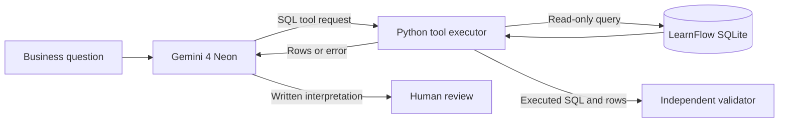

# Building a Text-to-SQL Agent with Gemini 4 Neon

**Purpose.** This independent write-up is intended for personal study and non-commercial use only.

This walkthrough studies how Khalid Abdelaty’s LearnFlow project handles a common analytics change. The product team first counts a learner as activated after a course enrollment, then changes the qualifying action to a completed lesson. The agent has to revise the SQL while preserving the reporting population, the seven-day observation window, and the acquisition-channel breakdown. A query can run successfully and still get any of those rules wrong. [DataCamp tutorial](https://app.datacamp.com/learn/tutorials/gemini-4-neon-api-tutorial-build-a-text-to-sql-agent-in-python)

## Start here

**Text-to-SQL** means turning a question in everyday language into a SQL query. For example, “What share of referred learners enrolled within seven days?” becomes a query that filters the learners, checks their enrollments, and calculates a percentage. An **agent** can also ask the application to run its query, read the returned rows, and use them to answer the question.

Think of the database as a set of related tables. A row in `learners` represents one account, while a row in `enrollments` represents one event. The `learner_id` column tells you which learner an event belongs to. SQLite is the database engine that stores these tables and runs the SQL. [Python SQLite tutorial](https://docs.python.org/3/library/sqlite3.html#tutorial)

Start with the counting rules in section 1, then run the practice exercise in section 3. The exercise uses Python and an in-memory database, so you can see the result locally before working with Gemini.

## 1. Define who counts and what counts

LearnFlow models a fictional learning platform. The `learners` table identifies who signed up, when they signed up, their acquisition channel, and their account type. `enrollments` records course enrollments. `lesson_events` records lesson activity, including starts and completions. Both activity tables can contain multiple rows for one learner. [Project repository](https://github.com/KhalidAbdelaty/gemini-4-neon-text-to-sql-agent)

| Rule | How it applies |
| --- | --- |
| Eligible learner | Signed up in October 2026 UTC and has `account_type = 'learner'`, which excludes staff and test accounts. |
| Observation window | Starts at the learner’s signup timestamp and ends just before signup plus seven days. |
| Original qualifying action | At least one course enrollment inside the window. |
| Revised qualifying action | At least one lesson event with `status = 'completed'` inside the window. |
| Channel activation rate | Unique eligible learners who qualify divided by all eligible learners in that channel. |

The reporting month filters **signups**, and each signup starts its own seven-day **activity** window. A learner who signs up at noon on October 31 can qualify with a November 2 event. An event at noon on November 7 falls exactly on the seven-day cutoff and is excluded. Filtering both tables to October would quietly shorten the window for late signups.

The eligible learners form the **cohort**, or group being measured. Within a channel, the **denominator** is the size of that group, and the **numerator** is the number who meet the activation rule. If two referred learners are eligible and one completes a lesson in time, the completion rate is `1 ÷ 2 × 100 = 50%`. The channel identifies how the learner arrived, such as by referral or email.

## 2. Give the model a tool and keep database access in Python

The model receives stable details such as table names, column types, and timestamp conventions in its system instruction. The product question supplies the metric definition. Putting the enrollment rule in the recurring system instruction would make it conflict with a later request to switch to completions.

The **schema** describes what the database contains. A **tool definition** tells Gemini which application function it can request and which arguments that function accepts. Here the tool is `run_sql` and its argument is the SQL text. The Interactions API carries messages between Gemini and the Python application. [Google function calling documentation](https://aistudio.google.com/docs/function-calling)



1. Send the question, schema instructions, and the `run_sql` tool definition to Gemini.
2. When Gemini emits a `function_call`, Python reads the proposed SQL, checks the tool request, and executes it through the SQLite wrapper.
3. Return rows or a query error in a `function_result` matched to the original call ID. Gemini can request another query or finish with an answer.
4. Start the revision from the completed baseline turn using `previous_interaction_id`. Resend the tools, system instruction, and generation settings because those settings apply to the current interaction. [Google Interactions API documentation](https://aistudio.google.com/docs/interactions-overview)

### See one tool request and reply

Suppose the user asks for completion rates by channel. Before writing that report, an agent could check which lesson statuses the database contains. Here is an illustrative tool request using the five-account practice data in section 3.

```json
{
  "type": "function_call",
  "id": "call_1",
  "name": "run_sql",
  "arguments": {
    "sql": "SELECT status, COUNT(*) AS event_rows FROM lesson_events GROUP BY status ORDER BY status"
  }
}
```

Python executes the SQL and sends back this result. The `call_id` matches the ID of the request, so Gemini can associate the rows with the query that produced them.

```json
{
  "type": "function_result",
  "name": "run_sql",
  "call_id": "call_1",
  "result": [
    {
      "type": "text",
      "text": "{\"columns\":[\"status\",\"event_rows\"],\"rows\":[[\"completed\",5],[\"started\",1]]}"
    }
  ]
}
```

The five `completed` rows are raw events. They include multiple events for one learner, events from ineligible accounts, and a completion at the cutoff. A second query has to apply the cohort and time window before counting unique learners. `call_id` pairs a tool reply with its request, while `previous_interaction_id` connects a new API call to the prior interaction. [Google function calling documentation](https://aistudio.google.com/docs/function-calling), [Google Interactions API documentation](https://aistudio.google.com/docs/interactions-overview)

### Follow the recorded run from question to answer

| Step | What happened | Why it matters |
| --- | --- | --- |
| Inspect the data | Gemini asked for account types and timestamp ranges. A separate query found 705 qualifying enrollment event rows and 12 enrollment events exactly on the seven-day cutoff. | The date and account rules need to match what the database actually contains. The cutoff affected real rows in the sample. |
| Produce the baseline | The grouped query counted 604 unique activated learners out of 971 eligible learners. | One learner can have several enrollment events. Counting the 705 event rows as learners would overstate activation. |
| Process the follow-up | Gemini checked lesson statuses and used `lesson_events` with `status = 'completed'` for the activity check. The selected cohort query stayed the same. | The product team changed which action counts. The reporting population and the seven-day window still apply. |
| Check the final result | The revised query counted 286 activated learners across the same five channels and 971 eligible learners. Python saved and checked the query that produced those rows. | You can inspect the query, its result, and the checks behind the explanation. |

The baseline and revision each used six Gemini requests and five SQL tool calls. The agent used some calls to inspect the data and others to produce report rows or totals. [Author’s recorded run](https://raw.githubusercontent.com/KhalidAbdelaty/gemini-4-neon-text-to-sql-agent/main/runs/example_run.json)

The wrapper opens the SQLite file read-only, denies operations outside its SQLite authorizer rules, and disables database attachments. It also limits query time and result size. The application bounds requests, tool calls, elapsed time, and estimated spend across the run. The spend threshold is checked between requests, so an in-flight request can take the final estimate above it. The model proposes SQL, while Python enforces what can run. [Agent implementation](https://github.com/KhalidAbdelaty/gemini-4-neon-text-to-sql-agent/blob/main/agent.py)

## 3. Work through the SQL on a small example

This five-account practice dataset lets you calculate both definitions side by side. To run it, put `setup.sql`, `activation.sql`, and `run_example.py` in the same folder using the code below. You need Python 3 with its `sqlite3` module. The example runs entirely on your computer and requires no Gemini account, API key, or package installation. [Python SQLite tutorial](https://docs.python.org/3/library/sqlite3.html#tutorial)

### Create the sample data

Save this block as `setup.sql`. `CREATE TABLE` defines the columns, and `INSERT INTO` adds sample rows. The same `learner_id` can appear several times in the two event tables.

```sql
CREATE TABLE learners (
    learner_id INTEGER PRIMARY KEY,
    signup_at TEXT NOT NULL,
    acquisition_channel TEXT NOT NULL,
    account_type TEXT NOT NULL
);
CREATE TABLE enrollments (learner_id INTEGER, enrolled_at TEXT);
CREATE TABLE lesson_events (learner_id INTEGER, status TEXT, event_at TEXT);

INSERT INTO learners VALUES
    (1, '2026-10-31 12:00:00', 'referral', 'learner'),
    (2, '2026-10-31 12:00:00', 'referral', 'learner'),
    (3, '2026-10-31 12:00:00', 'referral', 'staff'),
    (4, '2026-10-31 12:00:00', 'email', 'learner'),
    (5, '2026-11-01 00:00:00', 'referral', 'learner');

INSERT INTO enrollments VALUES
    (1, '2026-11-01 10:00:00'),
    (1, '2026-11-02 10:00:00'),
    (2, '2026-11-01 10:00:00'),
    (3, '2026-11-01 12:00:00'),
    (5, '2026-11-01 12:00:00');

INSERT INTO lesson_events VALUES
    (1, 'completed', '2026-11-02 12:00:00'),
    (1, 'completed', '2026-11-03 12:00:00'),
    (2, 'started',   '2026-11-02 12:00:00'),
    (2, 'completed', '2026-11-07 12:00:00'),
    (3, 'completed', '2026-11-02 12:00:00'),
    (5, 'completed', '2026-11-02 12:00:00');
```

### Write the activation query

Save this block as `activation.sql`. It first selects the eligible learners, then checks for each type of qualifying activity and calculates rates by channel.

```sql
WITH cohort AS (
    SELECT learner_id, acquisition_channel, signup_at,
           datetime(signup_at, '+7 days') AS window_end
    FROM learners
    WHERE account_type = 'learner'
      AND signup_at >= '2026-10-01 00:00:00'
      AND signup_at <  '2026-11-01 00:00:00'
), learner_flags AS (
    SELECT c.learner_id, c.acquisition_channel,
           EXISTS (
               SELECT 1 FROM enrollments AS e
               WHERE e.learner_id = c.learner_id
                 AND e.enrolled_at >= c.signup_at
                 AND e.enrolled_at < c.window_end
           ) AS enrolled,
           EXISTS (
               SELECT 1 FROM lesson_events AS l
               WHERE l.learner_id = c.learner_id
                 AND l.status = 'completed'
                 AND l.event_at >= c.signup_at
                 AND l.event_at < c.window_end
           ) AS completed
    FROM cohort AS c
)
SELECT acquisition_channel,
       COUNT(*) AS eligible_learners,
       SUM(enrolled) AS enrolled_learners,
       SUM(completed) AS completed_learners,
       ROUND(100.0 * SUM(enrolled) / COUNT(*), 2) AS enrollment_pct,
       ROUND(100.0 * SUM(completed) / COUNT(*), 2) AS completion_pct
FROM learner_flags
GROUP BY acquisition_channel
ORDER BY acquisition_channel;
```

Read the query in three parts.

1. **Select the cohort.** `WITH` names an intermediate result so the rest of the query can use it. The `cohort` result has one row per eligible learner. `WHERE` filters by account type and signup month, and `datetime(signup_at, '+7 days')` calculates each learner’s deadline. [SQLite date and time functions](https://sqlite.org/lang_datefunc.html)
2. **Check each learner’s activity.** `EXISTS` returns `1` if its inner query finds a match and `0` otherwise. The inner queries match on `learner_id` and apply the same time window. Only the lesson check also requires `status = 'completed'`. A learner with two qualifying records still gets a single `1`. [SQLite EXISTS documentation](https://sqlite.org/lang_expr.html#the_exists_operator)
3. **Calculate the rates.** `GROUP BY` gives one result per channel. `COUNT(*)` counts the eligible rows, and `SUM(enrolled)` and `SUM(completed)` add up the corresponding `1`s. Multiplying by `100.0` before dividing keeps the result in decimal arithmetic and expresses it as a percentage.

### Run the example

Save this block as `run_example.py`. The `:memory:` argument creates a fresh SQLite database each time the script runs.

```python
from contextlib import closing
from pathlib import Path
import sqlite3

folder = Path(__file__).resolve().parent
setup_sql = (folder / "setup.sql").read_text(encoding="utf-8")
activation_sql = (folder / "activation.sql").read_text(encoding="utf-8")

with closing(sqlite3.connect(":memory:")) as database:
    database.executescript(setup_sql)
    rows = database.execute(activation_sql).fetchall()

for channel, eligible, enrolled, completed, enrollment_pct, completion_pct in rows:
    print(f"{channel}: {eligible} eligible")
    print(f"  Enrolled:  {enrolled} ({enrollment_pct:.2f}%)")
    print(f"  Completed: {completed} ({completion_pct:.2f}%)")
```

Open a terminal in that folder and run `python run_example.py`. On Windows, use `py run_example.py` if your Python installation uses the `py` launcher. You should see the following results.

| Channel | Eligible | Enrolled | Completed | Enrollment rate | Completion rate |
| --- | ---: | ---: | ---: | ---: | ---: |
| Email | 1 | 0 | 0 | 0% | 0% |
| Referral | 2 | 2 | 1 | 100% | 50% |

### Trace the result one learner at a time

| Learner | In the cohort? | Enrolled flag | Completed flag | Why |
| --- | --- | ---: | ---: | --- |
| 1 | Yes | 1 | 1 | Multiple qualifying records still contribute one learner to each count. |
| 2 | Yes | 1 | 0 | The first lesson event has status `started`, and the completion is exactly at the cutoff. |
| 3 | No | — | — | The account belongs to staff. |
| 4 | Yes | 0 | 0 | An eligible learner with no activity still counts toward the channel’s denominator. |
| 5 | No | — | — | The signup falls in November. |

The original project enforces the same counting rule by finding distinct qualifying learner IDs and using a `LEFT JOIN` to bring them back to the cohort. A left join keeps every row from the cohort, even when the learner has no qualifying activity to join. [Recorded queries](https://github.com/KhalidAbdelaty/gemini-4-neon-text-to-sql-agent/blob/main/runs/example_run.json)

### Try two changes

1. In `setup.sql`, change learner 2’s completed event from `2026-11-07 12:00:00` to `2026-11-07 11:59:59`. Predict the referral completion rate, then rerun the script. It becomes **100%** because both eligible referral learners now qualify.
2. Restore the original data and add a third completed event for learner 1 inside the seven-day window. Rerun the script. The referral completion rate stays at **50%** because the added row belongs to a learner who already qualifies.

## 4. Verify the SQL that actually ran

An agent can execute several exploratory queries before producing a report. The project saves the latest successful query that returns the expected result columns and validates that executed SQL and its rows. It separately records whether the SQL printed in the response matches the saved query. This connects the answer to the actual database operation. [Agent implementation](https://github.com/KhalidAbdelaty/gemini-4-neon-text-to-sql-agent/blob/main/agent.py)

- **Compare with independent results.** Use handwritten SQL and a plain-Python calculation as references. Check each channel’s eligible count, activated count, and rate.
- **Test the rules on database copies.** Add cases that expose specific mistakes, such as a completion at the cutoff, duplicate events, a staff signup, and a late-October signup with qualifying November activity.
- **Check what the revision preserves.** Compare the channels and denominators with the baseline. The expected difference is in which learners qualify for the numerator.
- **Bound corrections.** The project allows one correction after a failed revision check. It sends the failed rule names while keeping the expected answers out of the model’s context. [Project validator](https://github.com/KhalidAbdelaty/gemini-4-neon-text-to-sql-agent/blob/main/reference.py)

Matching totals on one snapshot can hide mistakes. For example, an inclusive cutoff may look correct if the dataset happens to contain no events at that timestamp. A targeted test makes that distinction observable.

If your result differs from the expected table, use the symptom to choose what to check first.

| Symptom | First check |
| --- | --- |
| Referral completion is 100% on the original practice data. | Check for `status = 'completed'` and the strict `< window_end` cutoff. |
| Email disappears from the output. | Check that the query starts from eligible learners and keeps those without a matching event. |
| The activated count grows when you duplicate an event. | Check that `EXISTS` or an equivalent one-row-per-learner calculation runs before grouping. |

### Test queries that run but give the wrong answer

For each test, start with the original practice files, make just one change to `activation.sql`, and rerun `python run_example.py`. SQLite accepts each change. The expected counts show which rule broke.

| Change to the query | Result on the practice data | What the test catches |
| --- | --- | --- |
| Change `l.event_at < c.window_end` to `l.event_at <= c.window_end`. | Referral completion rises from 1 of 2 to 2 of 2 (100%). | Learner 2’s completion at the exact cutoff is incorrectly included. |
| Remove `AND l.status = 'completed'`. | Referral completion again rises to 2 of 2 (100%). | Learner 2’s in-window start is incorrectly treated as a completion. |
| Remove the `account_type = 'learner'` condition. Keep `WHERE signup_at >= '2026-10-01 00:00:00'` and the November cutoff. | Referral completion becomes 2 of 3 (66.67%). | The staff account changes the numerator and the denominator. |
| Add `WHERE completed = 1` after the final `FROM learner_flags`, before `GROUP BY`. | The email row disappears, and referral becomes 1 of 1 (100%). | Filtering to completers before counting shrinks the population being measured. |

The first two changes produce the same incorrect rate for different reasons. Use targeted tests and trace which learner changed status to find the underlying rule.

## 5. Does it really work?

| Channel | Eligible | Enrolled | Enrollment rate | Completed | Completion rate |
| --- | ---: | ---: | ---: | ---: | ---: |
| Partner | 144 | 100 | 69.44% | 46 | 31.94% |
| Paid social | 266 | 180 | 67.67% | 49 | 18.42% |
| Organic search | 291 | 173 | 59.45% | 99 | 34.02% |
| Referral | 133 | 78 | 58.65% | 62 | 46.62% |
| Email | 137 | 73 | 53.28% | 30 | 21.90% |
| **Overall** | **971** | **604** | **62.20%** | **286** | **29.45%** |

Overall activation fell by **32.75 percentage points**. Partner led on enrollment, and referral led on completion even though its own rate fell. Paid social moved from second to fifth. The overall rate uses the total counts across channels, so larger channels contribute proportionally more than smaller ones. [Recorded run data](https://raw.githubusercontent.com/KhalidAbdelaty/gemini-4-neon-text-to-sql-agent/main/runs/example_run.json)

The author’s recorded run passed 10 baseline checks and 13 revision checks without a correction. It took 134 seconds, made 12 model requests and 10 SQL tool calls, and had an estimated API cost of $0.2081. These figures describe one run on synthetic data. Estimating reliability or typical cost would require repeated runs across representative tasks and datasets. [Recorded run data](https://raw.githubusercontent.com/KhalidAbdelaty/gemini-4-neon-text-to-sql-agent/main/runs/example_run.json)

**Independent offline replay.** For this write-up, I downloaded the published SQLite database and confirmed its SHA-256 checksum, a fingerprint of the file, matched the checksum in the recorded run. I then opened the database read-only and ran the two saved final queries. All five channel rows, including the eligible counts, activated counts, and rates, matched the recorded results for both queries. A separate plain-Python calculation from the underlying learner and event rows also matched the eligible and activated counts in every channel. The replay verifies the saved SQL on that dataset. Evidence of Gemini generating and revising those queries comes from the original recorded API run. [Published database](https://github.com/KhalidAbdelaty/gemini-4-neon-text-to-sql-agent/blob/main/data/learnflow.db), [recorded run](https://raw.githubusercontent.com/KhalidAbdelaty/gemini-4-neon-text-to-sql-agent/main/runs/example_run.json)

The paid-social result answers two different questions depending on the denominator. The table’s **18.42%** is `49 ÷ 266`, the share of all eligible paid-social learners who completed a lesson. The **27.2%** figure is `49 ÷ 180`, the share of paid-social enrollees who did so in this dataset. A claim about those learners’ intent would require other evidence. SQL checks can establish that the numbers answer the metric question. Reviewing the explanation is a separate step. [DataCamp tutorial](https://app.datacamp.com/learn/tutorials/gemini-4-neon-api-tutorial-build-a-text-to-sql-agent-in-python)

## 6. How this helps with real analytics work

This pattern helps when someone needs a first SQL draft or wants to revise a report without restating every filter. The analyst can inspect which event, time window, and population the query uses. Saving the executed query makes it possible to reproduce the result or investigate a surprising number later.

| Example report | Change someone might request | What to check before using the result |
| --- | --- | --- |
| Product onboarding | Count users who verify an email within 24 hours of signing up, after previously counting users who open the verification screen. | Keep the same signup cohort. Count each person once, and check the timestamp of the actual verification. |
| Support response | Count tickets with a human reply within 24 hours, after previously counting any reply. | Know which field identifies the sender type. Keep unreplied tickets in the denominator and exclude automated replies from the numerator. |
| Order fulfilment | Count orders delivered by the promised date, after previously counting orders shipped by that date. | Keep the same order population, define how cancellations are handled, and confirm which time zone determines the cutoff. |

For a small support example, suppose 30 tickets are eligible. Within 24 hours of opening, 18 receive some form of reply, including 12 that receive a human reply. Changing the rule changes the rate from **60%** to **40%** and leaves the denominator at **30**. As in LearnFlow, several events on the same record still count once.

A request such as “show me engaged learners” still needs a definition of engagement. The analyst should settle the rules with the person asking, then review the query and the written interpretation. The recorded LearnFlow run demonstrates the workflow for one well-defined change.

## 7. Reproduce the original walkthrough

### Set up the project and open the recorded run

Use Python 3.11 or newer. These commands use Git and PowerShell on Windows. The virtual environment gives this copy of the project its own Python packages. [Project setup instructions](https://github.com/KhalidAbdelaty/gemini-4-neon-text-to-sql-agent#run-it)

```powershell
git clone https://github.com/KhalidAbdelaty/gemini-4-neon-text-to-sql-agent.git
cd gemini-4-neon-text-to-sql-agent
python -m venv .venv
.\.venv\Scripts\python.exe -m pip install -r requirements.txt
.\.venv\Scripts\python.exe reference.py
.\.venv\Scripts\python.exe -m streamlit run app_streamlit.py
```

On macOS or Linux, create the environment with `python3 -m venv .venv` and use `.venv/bin/python` in the last three commands. `reference.py` prints the expected tables. When Streamlit opens, select **Show the latest recorded run** to inspect the model’s queries, checks, and cost. In a fresh checkout this opens the bundled example without using an API key. [Project replay instructions](https://github.com/KhalidAbdelaty/gemini-4-neon-text-to-sql-agent#run-it)

A live run is optional. Use `.env.example` as a template for a local `.env` file, set `GEMINI_API_KEY` to a key from a paid Google AI Studio project, then run `agent.py` with the virtual environment’s Python. Keep `.env` out of version control. `build_data.py` rebuilds the synthetic database when needed. For the checksum check below, use the database shipped with the recorded run. [Project setup instructions](https://github.com/KhalidAbdelaty/gemini-4-neon-text-to-sql-agent#run-it)

### Replay the two saved queries with Python

For a direct check, save this script as `replay_queries.py` in a copy of the author’s repository. Run `python replay_queries.py` from that folder. It uses the repository’s `data/learnflow.db` and `runs/example_run.json` files to run both SQL queries locally.

```python
from contextlib import closing
from hashlib import sha256
from pathlib import Path
import json
import sqlite3

folder = Path(__file__).resolve().parent
db_path = folder / "data" / "learnflow.db"
run_path = folder / "runs" / "example_run.json"
run = json.loads(run_path.read_text(encoding="utf-8"))

if sha256(db_path.read_bytes()).hexdigest() != run["db_sha256"]:
    raise ValueError("Use the database version from the recorded run.")

with closing(sqlite3.connect(db_path.as_uri() + "?mode=ro", uri=True)) as database:
    database.execute("PRAGMA trusted_schema = OFF")
    for phase, result_key in (("original", "original"), ("revision", "revised")):
        sql = run["phases"][phase]["frozen_sql"]
        rows = database.execute(sql).fetchall()
        actual = {
            channel: [eligible, activated, rate]
            for channel, eligible, activated, rate in rows
        }
        if actual != run["results"][result_key]:
            raise ValueError(f"{phase}: replay differs from the recorded results")
        eligible_total = sum(row[1] for row in rows)
        activated_total = sum(row[2] for row in rows)
        print(f"{phase}: {activated_total}/{eligible_total} activated across {len(rows)} channels")
```

The script checks all result columns by channel and prints the totals. Expect `original: 604/971 activated across 5 channels` and `revision: 286/971 activated across 5 channels`.

## Sources

- The original tutorial was written by Khalid Abdelaty and published by DataCamp in November 2026. [Gemini 4 Neon API Tutorial: Build a Text-to-SQL Agent in Python](https://app.datacamp.com/learn/tutorials/gemini-4-neon-api-tutorial-build-a-text-to-sql-agent-in-python)
- Abdelaty’s accompanying repository contains the LearnFlow implementation, synthetic data, and validation code. [Project repository](https://github.com/KhalidAbdelaty/gemini-4-neon-text-to-sql-agent)
- The channel results, validation outcomes, and API usage figures come from the author’s saved experiment. [Recorded run](https://raw.githubusercontent.com/KhalidAbdelaty/gemini-4-neon-text-to-sql-agent/main/runs/example_run.json)
- Google documents how tool calls and conversation state work across API interactions. [Google function calling documentation](https://aistudio.google.com/docs/function-calling), [Google Interactions API documentation](https://aistudio.google.com/docs/interactions-overview)
- The practice exercise uses Python’s local SQLite interface and SQLite’s date and existence checks. [Python SQLite tutorial](https://docs.python.org/3/library/sqlite3.html#tutorial), [SQLite date and time functions](https://sqlite.org/lang_datefunc.html), [SQLite EXISTS documentation](https://sqlite.org/lang_expr.html#the_exists_operator)
